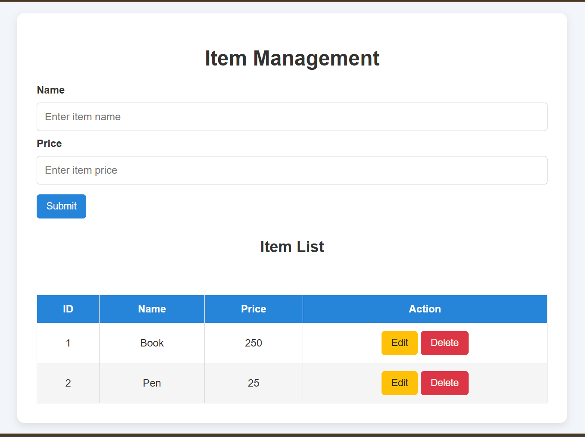
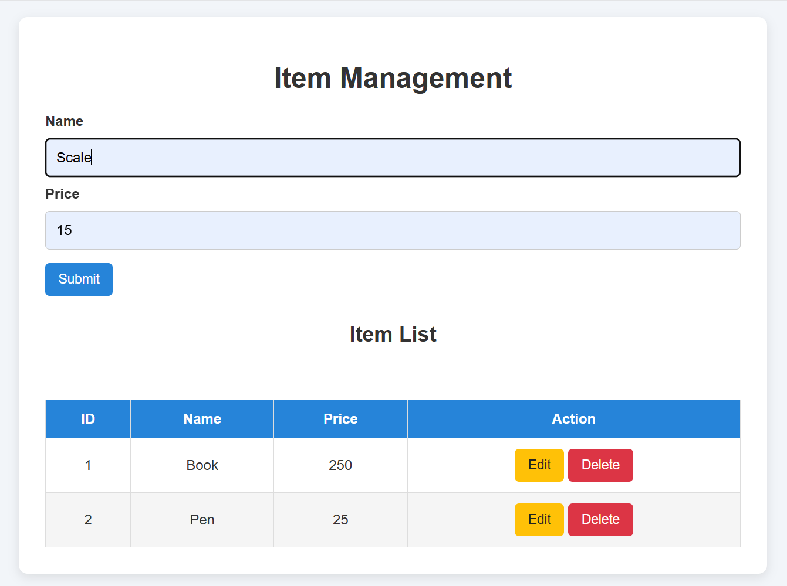
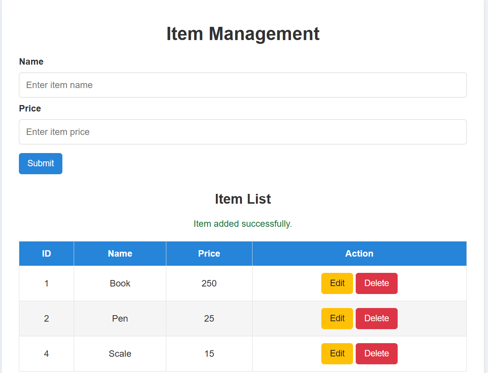
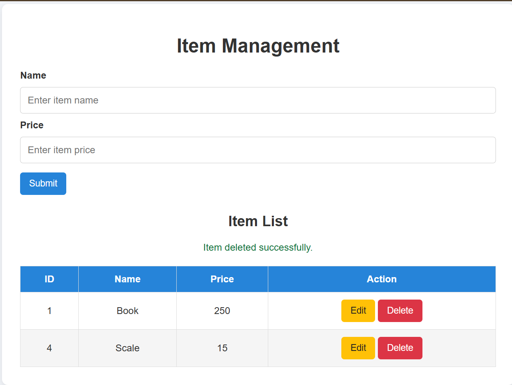

# MERN Lab Task 1 – CRUD Operations

## Aim
To develop a frontend for CRUD operations on an array of items using HTML, CSS, JavaScript, Express.js, and REST API.

## Technologies Used
- HTML
- CSS
- JavaScript
- Node.js
- Express.js
- REST API

## Features
- Create: Add new items.
- Read: Display all items.
- Update: Edit existing items.
- Delete: Remove items.

## Output Screenshot

## Output Screenshots

### 1. Item Management Interface


### 2. Adding an Item


### 3. Item Added Successfully


### 4. Item Deleted Successfully

## How to Run

1. Install Node.js.
2. Download or clone this repository.
3. Open the project folder in VS Code.
4. Install the dependencies:

   ```bash
   npm install
   ```

5. Start the server:

   ```bash
   npm start
   ```

6. Open `http://localhost:3000` in your browser.

## Note
The items are stored in a JavaScript array on the server. The data resets when the server restarts.
